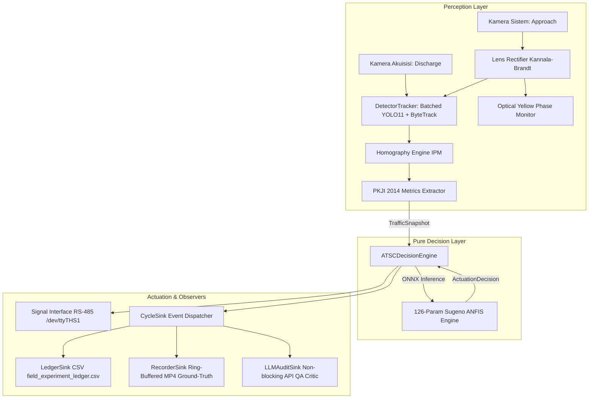
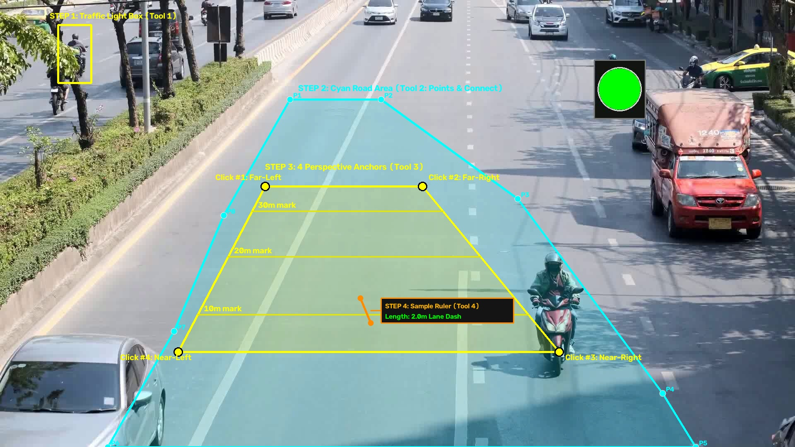
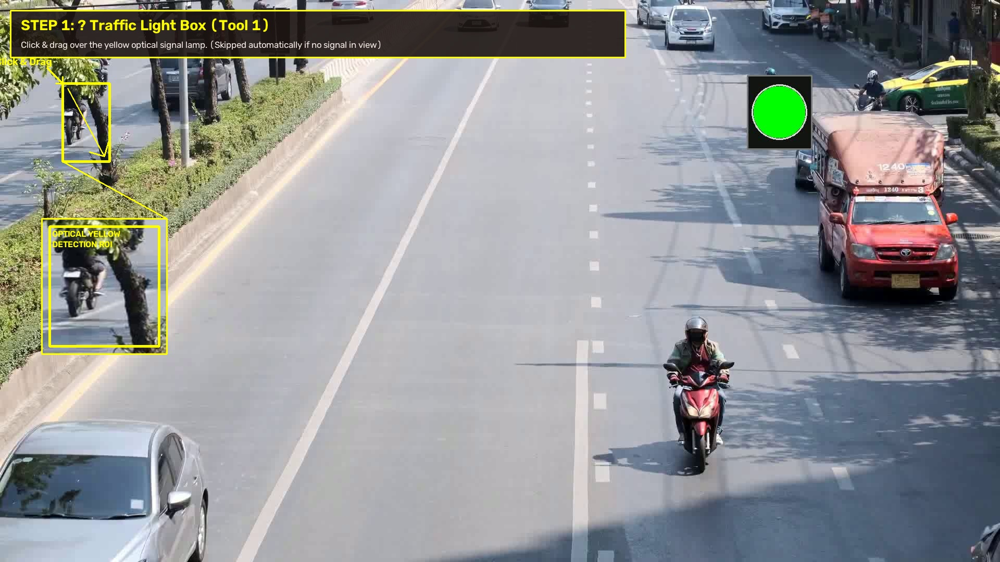
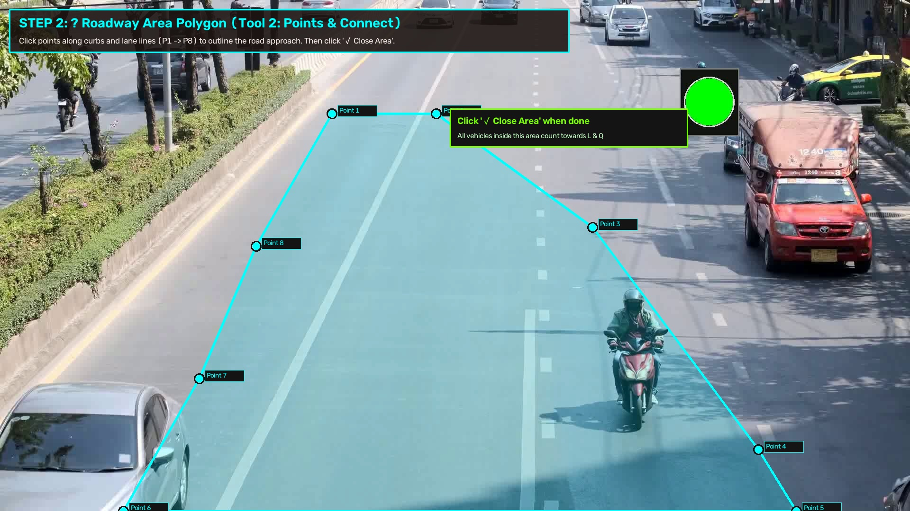
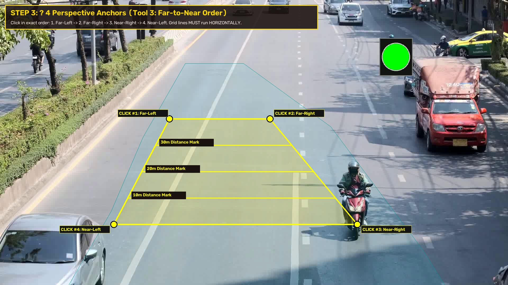
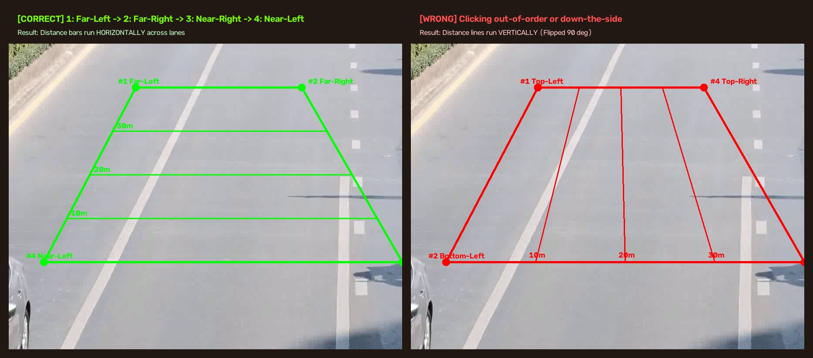
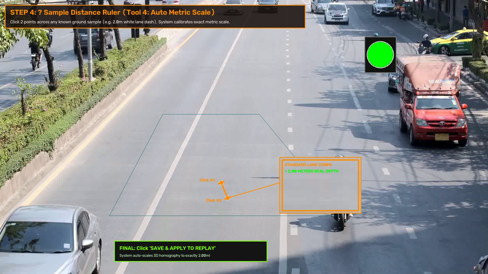
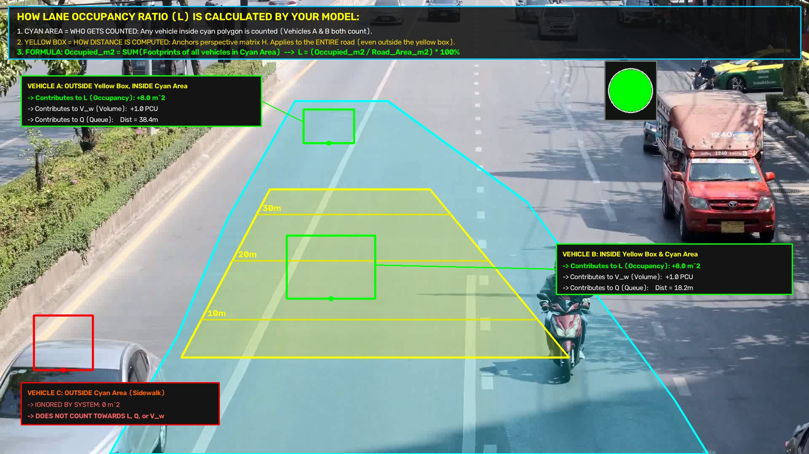

# DeployATSC edge runtime and observation app

The default app is a local, two-camera, **recommendation-only observation workspace** for the NVIDIA Jetson Orin Nano. Each camera has independent calibration and tracking. Capture ANFIS recommendations manually, compare them with observed timing, and retain separate runs for browsing and export after restart. Software checks do not establish paired-camera field accuracy or real-time performance.

```bash
cd jetson-atsc-core  # from the repository root
.venv/bin/python scripts/launch_ui.py --host 127.0.0.1 --port 8000
```

Open `http://localhost:8000`. Save each camera's calibration, review its physical scale evidence, then start a run. Saving a profile does not start playback. **Saved runs** provides vehicles, predictions, cycle comparisons, generation-bound pages, exact durable quantiles and ZIP export. New runs use `motion-phase-scale-v2`; timing eligibility, scale qualification and durability are separate. Old/missing qualification stays unknown.

For the prepared real-footage demonstration, run `.venv/bin/python scripts/launch_demo.py --preset data/demo_real/preset.json --device cuda:0 --port 8001` and open `http://localhost:8001`. Both camera profiles are loaded automatically; YOLO/ByteTrack and ANFIS run on real intersection video. The approximate shared-recording preset uses isolated storage. An optional generated scene is also available. See the [demo walkthrough and footage credits](docs/DEMO.md).

Observation sessions automatically use a verified local TensorRT FP16 engine when available. Build it on the target Jetson with `.venv/bin/python scripts/export_observation_engine.py`; the source `models/Final.pt` is preserved. The engine is bound to its weights, TensorRT version and GPU capability. Use `--backend pytorch` on either launcher for rollback, or `--backend tensorrt` to require the engine and reject an incompatible installation. Binaries are generated locally rather than committed. See [backend setup and validation](docs/TENSORRT_OBSERVATION.md).

Runtime evidence lives in `jetson-atsc-core/data/experiments/<run_id>/`; profiles live in `data/observation_profiles/`. The app's `src/experiment/` is its runtime measurement/storage backend. It does not modify the repository's `research/`, datasets, training, weights or experiment methodology. Original Jamika geometry is preserved; saves create separate profile revisions. Private source handles expire at process restart: re-enter the source locally and review/rebind before starting it again.

Both observation launchers bind to loopback, use one worker, reject reload and exclude legacy runtime routes. LAN remains disabled pending owner-provisioned gateway configuration and its conditional access checks. Legacy cabinet control requires explicit `--operation legacy-control` and is outside the observation workflow.

If storage fails, new measurement/capture admission stops and the last durable revision remains visible. Repair storage, then use the dashboard retry action or `POST /api/observation/recover?run_id=<id>` to finalize the interrupted run before explicitly starting another. Browsing/exporting saved evidence never resumes it. Native resource cleanup may outlast a stop timeout; check resource release and durable finalization separately.

See the [operator guide](docs/TWO_CAMERA_OBSERVATION.md) and [dated validation results and limits](docs/OBSERVATION_VALIDATION.md). The architecture and calibration tutorial below describe the legacy control/replay tools.
---

## 1. System Architecture



---

## 2. Directory Layout

```text
.
├── configs/
│   ├── brica_fisheye_calib.npz        # Kannala-Brandt K & D distortion matrices
│   ├── intersection_roi.json          # Homography, lamp ROI, physical area, mode config
│   └── hardware_config.json           # Serial/RS-485 ports, watchdog thresholds, fallbacks
├── models/
│   ├── Final.pt / yolo11s_fp16.engine # Batched YOLO11 vehicle detector
│   └── anfis_sugeno.onnx              # 126-parameter Sugeno ANFIS green-time engine [10s, 120s]
├── src/
│   ├── common/                        # Strongly-typed domain dataclasses (TrafficSnapshot, CycleEvent)
│   ├── perception/                    # Video ingest, lens unwarping, YOLO11+ByteTrack, phase monitor
│   ├── analytics/                     # Homography IPM engine & PKJI 2014 traffic metrics
│   ├── control/                       # ANFIS ONNX inference, pure decision engine, RS-485 interface
│   ├── monitoring/                    # Tegrastats hardware telemetry & dynamic thermal fallback
│   ├── storage/                       # Async MP4 video recorder
│   ├── audit/                         # Async LLM cycle auditor & heuristic fallback
│   └── sinks/                         # Pluggable cycle sinks (CSV ledger, video, LLM)
├── scripts/
│   ├── export_models.py               # TensorRT FP16 engine builder
│   └── replay_debug.py                # Deterministic single-threaded offline replay debugger
├── tests/                             # Comprehensive test suite (19 unit/integration tests)
├── edge_daemon.py                     # Central multi-threaded orchestrator daemon
├── requirements-edge.txt              # JetPack & edge dependencies
└── field_experiment_ledger.csv        # Empirical experiment CSV ledger
```

---

## 3. Installation & Setup

### Requirements
- Ubuntu 22.04 LTS (JetPack 6.x on Jetson Orin Nano, or Linux x86_64)
- Python 3.10+
- PyTorch, ONNXRuntime, OpenCV, Ultralytics, PySerial

```bash
# Clone repository
git clone https://github.com/Marsel204/DeploySkripsi.git
cd DeploySkripsi

# Install dependencies
pip install -r requirements-edge.txt
```

---

## 4. Usage

### 1. Legacy control daemon (explicit cabinet operation)
```bash
python3 edge_daemon.py --operation legacy-control \
    --mode DUAL_CAM \
    --source_sys /dev/video0 \
    --source_acq /dev/video1 \
    --headless
```

### 2. Running Field Simulation (Offline MP4 Video with Loop)
```bash
python3 edge_daemon.py --operation legacy-control \
    --mode DUAL_CAM \
    --source_sys /path/to/approach.mp4 \
    --source_acq /path/to/discharge.mp4 \
    --loop \
    --mock_hardware
```

### 3. Interactive Deterministic Replay Debugger
Inspect perception, IPM tracking, and ANFIS decisions frame-by-frame:
```bash
python3 scripts/replay_debug.py \
    --source /path/to/video.mp4 \
    --step
```
**Controls**:
- `[SPACE]` : Step forward 1 frame
- `[c]` : Run continuously until next Yellow Phase trigger
- `[p]` : Print detailed JSON state dump to console
- `[s]` : Save snapshot image with HUD overlay
- `[q]` : Exit

### 4. Running the Test Suite
```bash
.venv/bin/python -m pip install -r requirements-dev-observation.txt
CUDA_VISIBLE_DEVICES='' YOLO_OFFLINE=true YOLO_AUTOINSTALL=false \
  .venv/bin/python -m pytest tests/ -q
```

Browser checks use pytest Playwright with system Chromium at `/usr/bin/chromium`, serve the shipped HTML/JavaScript through an isolated local API, and use generated clips and fake inference. The full suite also requires benchmark media/trace assets and `models/yolo11s.pt`, which are absent in this checkout. The [validation report](docs/OBSERVATION_VALIDATION.md) separates those failures from the deterministic software gate. Tests do not download weights or qualify real cameras/GPU performance.

---

## 5. Web Dashboard & Interactive Calibration Tutorial

The observation dashboard runs locally. Use the operator guide above for its current save/review workflow:

```bash
# Launch ATSC Web Dashboard on port 8000
python3 scripts/launch_ui.py --host 127.0.0.1 --port 8000
```
Open **`http://localhost:8000`** in your browser.

---

### Historical legacy calibration tutorial

To calibrate a new camera angle or intersection, click **🎯 DRAW YELLOW BOXES & CORRIDOR** on the dashboard.



#### 🟡 Step 1: Traffic Light Optical Box (Tool 1)
* **Goal**: Isolate the optical traffic signal face (yellow lens) for phase trigger detection.
* **How**: Click & drag a bounding rectangle over the traffic signal housing.
* *Note*: If the camera view has no optical signal visible, the system automatically runs on the dynamic periodic fallback timer.



#### 🔷 Step 2: Roadway Containment Area (Tool 2: "Points & Connect")
* **Goal**: Define the exact physical roadway zone where vehicles should be counted.
* **How**:
  1. Click sequential points ($P_1, P_2, \dots, P_N$) following curved curbs, sidewalks, and lane edges from the stop line all the way up into the distance.
  2. Click **✓ Close Area** (or click near $P_1$) to seal the cyan polygon.
* **Behavior**: Any vehicle whose tires are inside this cyan boundary is included in traffic calculations (Occupancy $L$, Volume $V_w$, and Queue $Q$). Vehicles on sidewalks or opposing lanes are excluded.



#### 🟨 Step 3: 4-Point Perspective Anchor Grid (Tool 3)
* **Goal**: Teach the system the camera's tilt angle and 3D planar perspective foreshortening.
* **CRITICAL — Click in this exact Far-to-Near sequence**:
  1. **Click #1**: **Far-Left** (deep in the background, left lane divider)
  2. **Click #2**: **Far-Right** (deep in the background, right curb/lane edge)
  3. **Click #3**: **Near-Right** (foreground near camera, right curb/lane edge)
  4. **Click #4**: **Near-Left** (foreground near camera, left lane divider)



> [!WARNING]
> **Avoid the 90° Axis Rotation Mistake**:
> * **CORRECT**: Clicking Far-Left $\to$ Far-Right $\to$ Near-Right $\to$ Near-Left produces **horizontal distance bars** across the lanes (`10m`, `20m`, `30m`).
> * **WRONG**: Clicking down the side of the road produces **vertical lines** with distance markers along the bottom edge, inverting the lateral ($X$) and longitudinal ($Y$) axes.



#### 📏 Step 4: Sample Distance Ruler (Tool 4)
* **Goal**: Automatically tune and verify physical ground metric scaling.
* **How**:
  1. Click **Point 1** and **Point 2** across a known ground landmark (e.g. the start and end of a standard $2.0\text{m}$ white dashed lane line).
  2. Set **Length (m)** to `2.0` (or your sample's real length).
  3. The system automatically computes the scaling factor $S$ and applies it to the homography matrix $H$, guaranteeing $< 2\%$ metric error across the entire approach.
4. Click **💾 SAVE & APPLY TO REPLAY** to immediately re-launch replay with the verified calibration.



---

### How Vehicles are Counted Towards Model Metrics ($L$, $V_w$, $Q$)



* **Perspective Correction Applies Everywhere**: The homography matrix $H$ derived from the 4 anchor points is a continuous geometric projective transform. It calculates exact metric distances for all vehicles across the entire road plane—including vehicles 30 meters beyond the anchor box.
* **Occupancy Ratio ($L$)**:
  $$\text{Occupied Area } (\text{m}^2) = \sum (\text{Footprints of ALL vehicles in the Cyan Road Area})$$
  $$L = \left( \frac{\text{Occupied Area}}{\text{Physical Road Area}} \right) \times 100\%$$
* Any vehicle inside the **Cyan Polygon** (even if outside the small yellow anchor box) contributes $100\%$ to $L$, $V_w$, and $Q$.

