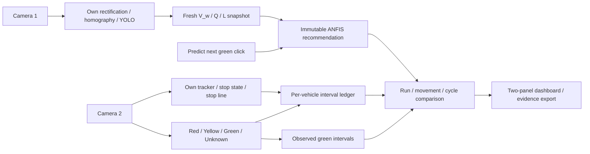

# Two-camera observation experiment: implementation plan

Status: M00–M17 implemented locally. See [validation evidence and limitations](../OBSERVATION_VALIDATION.md) and [operator setup](../TWO_CAMERA_OBSERVATION.md). Conditional graded LOS work remains dependent on the study methodology and required measurement coverage.

Source requirements: [reviewed specification](../specs/separate-signal-camera.md). Design reference: [interactive layout preview](../specs/separate-signal-camera-preview.html).

## Result to deliver

Camera 1 measures road traffic using its own optics, perspective calibration and YOLO, then produces an ANFIS recommendation when the operator clicks **Predict next green**. Camera 2 independently tracks vehicles, measures stopped red waits, observes actual signal phases and measures actual green. The dashboard joins these records by movement/run/cycle, displays the two views and exports reproducible evidence. This is an observation experiment: no serial controller is opened and no signal timing is changed.

Implement sequentially in the milestones below. Each milestone changes at most three files, including its tests. Do not launch additional agents, publish a PR, enroll the repository, or deploy as part of this plan.

## Decisions used by this plan

| Decision | Implementation choice |
| --- | --- |
| Camera roles | Keep `kamera_sistem` / `source_sys` and `kamera_akuisisi` / `source_acq`; acquisition owns vehicle tracking **and** the light box. No third camera. |
| Runtime | One shared observation engine used by file replay and live dashboard sessions. The observation CLI starts the same local dashboard/API; it does not create a second competing camera owner. |
| Mode | Dashboard defaults to explicit `observation`. Legacy replay remains a documented compatibility path. Existing controller operation is kept behind an explicit legacy-control selection and is never constructed by the observation path. |
| Prediction | Manual, one pending request per upcoming cycle, with a stable request ID and frozen camera-1 snapshot. Inference runs outside the capture/event loop; phase/vehicle observations continue while it completes. |
| Identity | Initially use separate `DetectorTracker` / YOLO predictor instances per camera for correctness. Qualify IDs by run, camera and tracking epoch. Sharing inference weights is a later measured optimization, not a prerequisite. |
| Acquisition stop measurement | Require camera-2 metric calibration for the initial implementation. Provisional pilot policy: enter stopped at ≤0.3 m/s sustained for 0.3 s; exit at ≥0.5 m/s sustained for 0.3 s. Preserve camera 1's existing queue threshold. These are configurable measurement settings, not validated research constants. |
| Occlusion and gaps | Retain an associable ID for up to 1 s; do not fill missing time with assumed stopped/red state. Intervals over 0.5 s without usable measurements are unknown. Validate/tune these provisional limits against annotated footage. |
| Signal | Acquisition head ROI plus optional red/yellow/green lamp subregions; unknown is a first-class state. Confirm changes with three distinct valid frames and retain onset/evidence and confirmation timestamps separately. |
| Green timing | Use the first qualifying green evidence through the first qualifying yellow evidence, after debounce confirmation. Direct unexpected green→red or an unknown gap makes the normal green interval incomplete rather than inventing a yellow boundary. |
| Time | File replay uses video presentation time; live capture uses monotonic acquisition time and a sequence number. Wall-clock UTC is provenance only. Never calculate vehicle waits by counting frames or time between UI polls. |
| Alignment | `acquisition source time = experiment time + configured offset`. Source start/EOF and offset validity are explicit. No cross-camera vehicle re-identification is needed. |
| LOS | Selection has been requested from the user. Until a framework/edition and measurement coverage are specified, implement the eligibility/status contract and display **ungraded** with a reason. Do not derive an LOS grade from red wait. A graded calculation is conditional on that research choice and its required inputs. |
| Research scope | Initial result is observed timing/waits and a recommendation-versus-actual comparison. Any causal improvement or counterfactual ANFIS LOS estimate requires a separately specified treatment/simulation. |

The stop, gap and phase settings are recorded in every run manifest and exposed in experiment setup. Do not silently change them mid-run. Source resolution, rectification or metric calibration changes close the current run or require a new run/calibration revision.

## Architecture and contracts

Keep experiment records in new `src/experiment/` modules instead of expanding legacy actuation records and rewriting historical CSV headers. Reuse the pure ANFIS decision engine and road analytics. Keep the existing yellow-only monitor for legacy behavior; add a separate multi-color observer for the experiment.

Each frame has `{camera_role, sequence, source_timestamp, experiment_timestamp, frame, quality}`. Each record carries `schema_version`, `run_id`, `movement_id`, source/calibration revisions and evidence time. A sequence can be processed once. Camera-2 missing IDs or uninitialized velocity are **unknown**, not stopped vehicles.

File Pause freezes replay time. Live Pause suspends observation while real camera time continues: flag the gap and incomplete intervals, then resume from fresh frames with appropriate tracker/phase reinitialization. Do not buffer an unlimited live backlog or pretend that vehicles stopped waiting while the dashboard was paused. Live sessions cannot Step or rewind. Restarting either source creates a new source/tracker epoch and explicit gap evidence.

New observation API contracts are additive:

| Contract | Responsibility |
| --- | --- |
| `POST /api/observation/start` | Validate run policy, two role-specific sources/calibrations, replay/live mode and offset; atomically open both and return run ID/readiness. |
| `POST /api/observation/control` | Pause/resume/step/stop with mode-aware behavior. Step is file-replay only. Live sessions report unsupported stepping rather than pretending to rewind cameras. |
| `POST /api/observation/predict` | Accept run ID/request ID, capture a valid system snapshot and enqueue at most one inference. Return its pending/completed record without stopping acquisition. |
| `POST /api/observation/predictions/{id}/cancel` | Retain an explicitly cancelled pending record so an unmatched prediction cannot drift into a later cycle. |
| `GET /api/observation/telemetry` | Return per-camera readiness/health/time, current phase, prediction state, current waits, comparisons and LOS eligibility; paginate completed vehicle records. |
| `GET /stream/observation/{system\|acquisition}` | Read the corresponding already-produced JPEG; no second capture or inference loop per browser connection. |
| Role-aware snapshot and calibration routes | Use the same per-camera transform as processing; save independent drafts/profiles and enforce image bounds. |
| `GET /api/observation/export` | Export a consistent run snapshot containing manifest, predictions, phase intervals, vehicle records and cycle summaries. |

Validate role and source type explicitly: local files are checked as files; device paths and RTSP sources are opened through the live adapter, not rejected by a blanket `os.path.exists`. Keep sources local to this trusted experiment interface; do not expose controller actions through new endpoints.

## Milestones

### M00 — Isolate test fixtures and record the baseline

Files: `tests/conftest.py`, `tests/test_roi_calibration.py`, `tests/test_multipoint_polygon_and_ruler.py`.

Before product changes, record source/model versions and the hash of the user's Jamika profile. Provide reusable synthetic clips/calibration copies and temporary output directories. Move calibration test writes away from committed/user profiles without weakening their geometry assertions. Run baseline checks; record missing-dataset/model failures separately rather than claiming the suite is green.

Acceptance: tests use `tmp_path` for generated media/profiles/ledgers; the user's profile hash is unchanged. Core ANFIS, decision, type, phase, optics and analytics tests have a recorded baseline.

Dependency: none. Rollback: undo only these fixture changes; retain the baseline report and never replace the user's profile from Git.

### M01 — Define observation records and run policy

Files: `src/experiment/contracts.py`, `src/experiment/__init__.py`, `tests/test_observation_contracts.py`.

Define camera-role configuration, frame identity, phase evidence, prediction lifecycle, vehicle intervals, cycle comparison, quality/censoring flags and versioned run metadata. Separate source time, experiment time, inference wall latency and UTC provenance. Validate offsets, thresholds, role uniqueness and observation mode.

Acceptance: records serialize/round-trip; invalid timing/geometry policy is rejected; namespaced identities cannot collide across run/camera/epoch. No legacy `CycleEvent`/ledger schema change.

Dependency: M00. Rollback: remove the unused new contract modules and their tests.

### M02 — Implement independent camera calibration

Files: `src/experiment/calibration.py`, `src/perception/lens_rectifier.py`, `tests/test_observation_calibration.py`.

Load legacy road geometry without overwriting it. Build independent system/acquisition transforms, including explicit no-rectification mode and acquisition metric homography. Bind geometry to source dimensions/transform revision. Store observation profiles separately; legacy road-source lamp coordinates are not auto-transferred to acquisition.

Acceptance: 1920×1080 system and 1280×720 acquisition round-trip independently; preview and inference coordinates agree within one processed pixel. Reject degenerate geometry and out-of-bounds signal/stop regions. Changed lens/resolution invalidates only the corresponding binding; the Jamika profile hash is unchanged.

Dependency: M01. Rollback: revert the rectifier extension and remove new adapters; preserve saved observation profiles as files for review.

### M03 — Observe actual signal phases and cycle boundaries

Files: `src/perception/signal_phase_observer.py`, `tests/test_signal_phase_observer.py`.

Implement Red/Yellow/Green/Unknown detection for the selected acquisition signal head, debouncing on distinct frames. Expose normalized evidence scores rather than claiming calibrated probabilities. Store onset/evidence and confirmation times, partial boundaries and movement association. Handle ambiguous/conflicting/occluded/flashing observations as unknown.

Acceptance: green t=30–55 yields 25 s within the declared input-frame tolerance after confirmation; no yellow never implies green; an unknown boundary cannot yield a complete actual interval. Repeated frame reads cannot complete debounce. Legacy yellow tests still pass.

Dependency: M01–M02. Rollback: remove this unused observer; leave the legacy phase monitor unchanged.

### M04 — Isolate camera tracking identities and velocity validity

Files: `src/perception/detector_tracker.py`, `tests/test_camera_tracker_isolation.py`.

Use independent predictor/tracker instances and histories for the two cameras. Add stable-ID and velocity-validity metadata. Keep detection-only fallback available for road analytics, but disallow its per-frame array indices as acquisition evidence. Require enough valid metric observations before classifying a vehicle as stopped.

Acceptance: identical numeric local IDs from camera 1 and 2 never share trajectories; a reset creates a new epoch; detector-only fallback and velocity warmup create unknown acquisition measurements instead of false waits. Existing class-mapping/road tests retain their behavior.

Dependency: M01–M02. Rollback: revert the tracker extension; experimental timing remains disabled until stable-ID requirements are met.

### M05 — Accumulate vehicle waiting and discharge evidence

Files: `src/experiment/vehicle_waits.py`, `tests/test_vehicle_waits.py`.

Integrate valid stopped intervals over the acquisition movement region. Split intervals by phase/cycle, maintain total stopped and red-only wait separately, apply hysteresis with evidence timestamps, and count directional stop-line crossings once. Preserve identities across cycles and flag initial/terminal censoring, gaps and lost tracks.

Acceptance: stopped t=10–34 and red through t=30 produces red wait 20 s and total stopped 24 s within measurement tolerance. A moving red-exposed vehicle has zero stopped red wait. Repeated frames, pauses, missing IDs and unknown phase add no fabricated waits; two-red vehicles retain cumulative history; a crossing counts once.

Dependency: M03–M04. Rollback: remove the new accumulator; keep raw tracker/phase evidence and preserve the legacy discharge counter.

### M06 — Implement idempotent manual predictions

Files: `src/experiment/predictions.py`, `tests/test_manual_predictions.py`.

Capture an immutable valid camera-1 snapshot and claim a request ID under a lock. Run the existing ANFIS engine in a bounded one-request worker outside the observation loop. Retain pending/completed/late/cancelled/unmatched states, actual phase association and separate click/output leads. Continue observing the next green while inference is in flight.

Acceptance: double click/retry creates one result; a second pending request is rejected with a clear conflict; stale/invalid camera-1 data cannot predict. A green onset during inference yields a Late completed result, not a valid pre-green comparison. Cancellation stays in evidence and cannot bind to a later cycle.

Dependency: M01, M03. Rollback: disable the capture endpoint/button and remove this module; retain any recorded predictions.

### M07 — Join the observation engine

Files: `src/experiment/engine.py`, `tests/test_observation_engine.py`.

Compose system metrics, acquisition tracks/phase, waits and pending predictions behind one thread-safe runtime. Handle phases with no recommendation and recommendations with no complete actual cycle. Resolve simultaneous events deterministically, keep vehicle journeys independent of cycle resets, and retain chronological intervals for measurement recomputation.

Acceptance: a known paired sequence produces one linked prediction/actual cycle with the expected waits and sample counts. Two movements/runs cannot mix. Invalid road metrics, tracker gaps and incomplete phase boundaries produce explicit exclusions. No import or call into serial actuation is required by this engine.

Dependency: M03–M06. Rollback: remove the unused engine, keeping tested independent components and legacy replay functional.

### M08 — Implement deterministic paired file replay

Files: `src/experiment/sources.py`, `tests/test_observation_replay.py`.

Add file-source adapters using presentation timestamps with validated FPS fallback when PTS is unavailable. Apply offsets; advance acquisition frames by time rather than equal frame index. Use bounded lookahead, disable automatic looping for measurement runs, and support Pause/Resume/Step/EOF without duplicate processing.

Acceptance: 25 FPS system / 30 FPS acquisition with a known offset yields the same interval results as an event fixture. Repeated reads or pause add no wait; Step consumes newly due acquisition frames exactly once. Early EOF marks partial records and releases both captures on stop/error.

Dependency: M01, M07. Rollback: remove these unused file adapters; preserve the existing single-file replay entry point.

### M09 — Add timestamped live camera adapters

Files: `src/perception/frame_grabber.py`, `src/experiment/sources.py`, `tests/test_observation_live_sources.py`.

Extend capture with monotonic timestamps, frame sequence and health/drop information while keeping the legacy `read()` return contract. Add a bounded observation read path with timeout/cleanup, using the existing device/RTSP pipelines. Do not reuse the existing latest-frame wall-clock loop to measure recorded-video waits.

Acceptance: repeated latest-frame reads expose the same sequence; one frame cannot advance phase or waits twice. Two injected live sources retain independent dimensions/times; startup failure rolls back both resources. Dropped sequences and stale sources set quality flags; stop returns within a bounded timeout.

Dependency: M08. Rollback: revert the added capture API and live adapters without changing the legacy `read()` interface.

### M10 — Manage observation sessions and distinct previews

Files: `src/ui/observation_session.py`, `src/ui/session_manager.py`, `tests/test_observation_sessions.py`.

Own one observation engine/source pair per run; produce separate annotated JPEGs and telemetry. Save role-specific calibration without implicit playback restart. Atomically validate/open required sources, bound pending work, freeze final run evidence on stop, and route compatibility sessions explicitly.

Acceptance: two files produce distinct role-tagged previews; each snapshot is transformed exactly as its role's processing frame. Replacing/stopping a run closes both sources, predictions and worker resources; a failed acquisition startup does not leave a partially active run. Shared-video testing requires an explicit label/configuration.

Dependency: M02, M07–M09. Rollback: disable observation session selection; restore only the integration changes, retaining original single-source replay.

### M11 — Persist and export experiment evidence

Files: `src/experiment/export.py`, `tests/test_observation_export.py`.

Write an isolated run directory with an immutable manifest and linked versioned prediction/phase/vehicle/cycle records. Export consistent snapshots under a short lock, streaming serialization outside the acquisition loop. Use JSONL for interval/detail records and CSV for reviewable summaries. Preserve unknown/censored counts and denominator definitions; do not append new schemas to old ledgers.

Acceptance: an exported run reconstructs recommendation, actual green, multi-cycle waits and exclusions. Snapshotting while a run continues produces a consistent revision; stop preserves partial intervals. Export errors are visible, not silently dropped, and legacy CSV files are unchanged.

Dependency: M07, M10. Rollback: disconnect the exporter and keep new run directories intact; never delete collected evidence during rollback.

### M12 — Implement comparison statistics and LOS eligibility

Files: `src/experiment/summary.py`, `tests/test_observation_summary.py`.

Calculate signed recommendation-minus-actual duration, per-cycle/cumulative observed waits, mean/median/P95, counts and data-quality coverage using documented populations. Include observed zero-wait vehicles in eligible vehicle denominators; keep censored observations separate. Add method/edition/scope/coverage fields and an LOS-unavailable reason whenever requirements are unmet.

Acceptance: fixed numeric fixtures reproduce expected differences and quantiles; served-only or stopped-only samples cannot masquerade as the entering population. Partial records remain counted and disclosed. Missing methodology/coverage yields no grade or causal-improvement claim.

Dependency: M05–M07, M11. Rollback: expose raw evidence only and retain exports; remove derived summaries without mutating measurements.

Conditional follow-up if the user selects a graded LOS framework: add `src/experiment/los.py`, `tests/test_observation_los.py`, and a method-policy reference under `docs/`. First specify the authoritative framework/edition, free-flow/arrival-departure evidence and analysis period; then implement an independently checked worked example. Do not replace control delay with red wait or import thresholds from an unspecified method. This conditional work belongs before final acceptance when grading is in scope.

### M13 — Expose validated observation API contracts

Files: `src/ui/app.py`, `tests/test_observation_api.py`.

Add the contracts above with strict typed camera calibration/source/policy validation. Include polygon and sample-ruler data explicitly—the existing save model omits these optional fields despite the UI sending them. Return structured readiness/conflict/quality responses, role-specific streams, paginated vehicles and exports. Resolve the active run atomically; do not invoke capture or inference on every telemetry request.

Acceptance: API tests cover two roles, invalid/missing source/ROI, duplicate/late capture, cancellation, distinct streams and consistent export. File/device/RTSP validation follows source type. Legacy endpoints retain documented behavior; periodic/yellow triggers cannot produce automatic observation recommendations.

Dependency: M10–M12. Rollback: remove the additive observation routes and restore legacy routes only; keep run artifacts and user calibration.

### M14 — Build the two-panel setup and calibration UI

Files: `src/ui/static/index.html`, `tests/test_observation_dashboard.py`.

Implement the reviewed layout: camera 1 system tools and camera 2 acquisition/light/waiting/stop-line tools; role-specific source loaders/readiness; independent drafts; letterbox-aware pointer mapping. Include camera-2 metric-calibration setup for stop classification. Group playback controls and separate profile save from run start. Prepare DOM hooks for the next milestone's comparison/vehicle data.

Acceptance: 1440px shows side-by-side panels and 390px stacks without overflow; keyboard/focus/labels work. Different-resolution canvases map points within one processed pixel. Cancelling a draft affects only its camera. The light box cannot be drawn on camera 1, and sources are never silently shared.

Dependency: M13. Rollback: restore the preceding dashboard version; retain role-specific saved profiles and the standalone preview.

### M15 — Connect prediction, waiting ledger and comparison views

Files: `src/ui/static/index.html`, `tests/test_observation_dashboard.py`.

Wire Predict next green with one request ID per operator action, pending/late/unmatched states and cancel. Show separate observed phase/actual-green timer, stable-ID red-wait/total-stopped rows, cycle comparison and quality/LOS status. Poll bounded summaries and paginate completed vehicles; render by stable namespaced identity. Add evidence export and explicit stopped/ended/disconnected states.

Acceptance: one button press yields one record and no automatic repeat on reconnect. Phase green cannot be labeled a pre-green capture. Missing/partial waits display their quality, not a misleading zero. Results show observed/recommended values distinctly; unavailable LOS has a reason; stop removes stale live labels. Test the actual interaction flow in a browser, not only string searches.

Dependency: M14, M06, M11–M13. Rollback: disable observation interaction/results and restore M14's layout; evidence remains available via API/export.

### M16 — Wire the observation production entry point

Files: `edge_daemon.py`, `scripts/launch_ui.py`, `tests/test_observation_entrypoint.py`.

Add explicit `--operation observation` and reuse source/config options to start the same dashboard/observation runtime, with live or replay source mode and a manual prediction API/button. Route this choice before constructing `EdgeDaemon`, reading hardware configuration, creating `SignalInterface`, starting watchdogs or registering controller/audit sinks. Keep legacy controller startup behind an explicit choice; an existing single-source client is not permission to start control mode.

Acceptance: spies that raise on any `SignalInterface` construction/connect/watchdog/heartbeat/dispatch prove all observation startup/run/stop paths avoid hardware. Live dashboard and CLI operate on the same camera-owner instance; manual capture works through the same API. Legacy mocked-controller tests retain their intentional explicit control path.

Dependency: M09–M10, M13–M15. Rollback: remove the observation CLI routing only; continue using the direct dashboard observation path, without enabling controller behavior as a fallback.

### M17 — Validate the whole experiment and document setup

Files: `tests/test_observation_pipeline.py`, `tests/test_observation_dashboard_browser.py`, `docs/TWO_CAMERA_OBSERVATION.md`.

Run full paired-video experiment flows and the relevant existing regressions after integrating all milestones. Add browser automation if a compatible browser is available; record any environment prerequisite rather than weakening coverage. Document two-camera calibration, source offsets, manual prediction, vehicle records, policy versions, LOS eligibility and export interpretation.

Acceptance: a synthetic end-to-end run reconstructs the 25 s actual green and 20 s red / 24 s total stop example, including a valid recommendation and a separate deliberately late one. Verify independent geometry/tracker state, loss/EOF/stop cleanup and zero hardware calls. On this Jetson, report measured per-role FPS, inference latency, backlog/drop counts and resident memory. No unsupported GPU/performance or field-validity claim is made from `CUDA available` alone.

Dependency: M00–M16 and the conditional LOS work if selected. Rollback: revert the last failing product milestone's files and rerun its dependent checks; preserve evidence and calibration. Documentation/test corrections can be retained independently.

## Verification and release boundaries

For each product milestone, first demonstrate the relevant requirement failure with focused tests, then implement and rerun that focused coverage. Broaden to affected regression tests at integration points; run the applicable full suite once the implementation is assembled. Do not edit a test merely to hide a timing/identity/hardware failure. Pure event/contract tests must not require GPUs or network downloads; separately test adapter/model integration with the actual installed models.

Important existing checks include `test_phase_monitor.py`, `test_types.py`, `test_decision_engine.py`, `test_anfis_inference.py`, `test_homography_metrics.py`, `test_optics_rectifier.py`, `test_detection_class_mapping.py` and relevant UI/calibration/sink/daemon tests. Dataset paths and mismatched expected model assets are baseline limitations to fix with explicit fixtures or report—not passing tests by default.

The baseline/pilot dependency environment already exists under `.venv`; use it and record its package/model revisions. Add any new test dependency to a dedicated reproducible development dependency file as a small preparatory milestone if needed. Keep the current running dashboard and the user's edited profile intact during development; use a separate port/run directory for implementation smoke checks, then restart the real dashboard only for the final local demonstration.

Field readiness additionally needs two aligned recordings or real inputs observing the same movement, independent camera-2 metric and signal calibration, an annotated phase/vehicle ground-truth sample, and the selected LOS method if grading is required. These are data/setup prerequisites, not GitHub owner/CI provisioning requirements. The repo is not AEK-enrolled; no frozen-harness/GitHub approval workflow is introduced by this plan.

The subsequent build request authorized these local milestones. Publishing, merging and physical controller actuation remain separate actions. Rollbacks target only this implementation's changes; never use a broad reset/checkout that discards the user's existing Jamika calibration or collected recordings.
