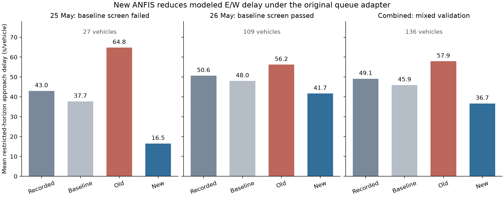
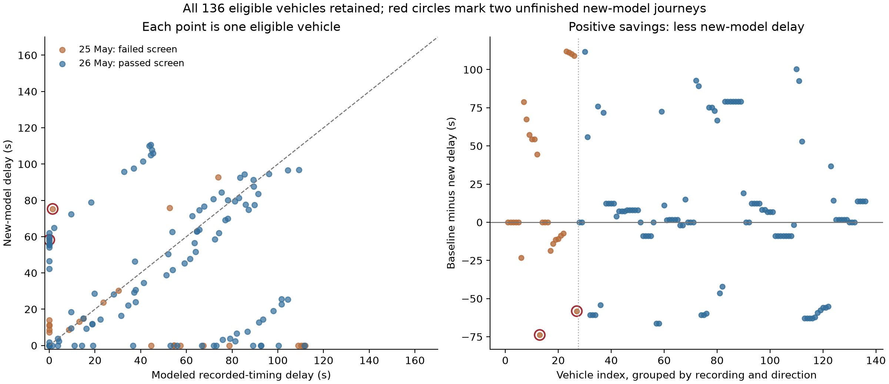

# Vehicle-by-vehicle backtest of the new ANFIS

**The new model reduces estimated east/west delay under the same point-queue adapter used previously.** On the better-validated 26 May recording, mean delay falls from **47.98 to 41.67 seconds per vehicle: 6.31 seconds (13.2%) less**, with no new-model vehicles unfinished. The old model produced 56.20 seconds. This is a conditional development estimate on reused recordings, not proof of whole-intersection or field benefit.

Here, the old model is the app's previously deployed ONNX from the original FLUID backtest. The separately supplied TrainANFIS checkpoint is not included in this comparison.

## Comparison for every eligible vehicle

The same **136 eligible test vehicles** were scored: 27 on 25 May and 109 on 26 May. All **190 modeled test vehicles**, including 54 background/excluded-from-scoring vehicles, remained in the evolving queues. The calibration recording was replayed separately: 143 modeled, 123 scored. The audit CSV retains all 333 modeled vehicles across the three recordings. No unsupported vehicle was assigned an invented counterfactual result.

Positive savings = modeled recorded-timing baseline delay minus new-model delay. Delay means reference-derived readiness-to-entry delay in the 45 m corridor, accumulated to the same recording horizon. Recorded stopped seconds are exported separately and are not treated as the same quantity.

| Recording | Scored vehicles | Recorded reference (s) | Modeled original timing (s) | Old model (s) | New model (s) | Reduction vs modeled original |
| --- | ---: | ---: | ---: | ---: | ---: | ---: |
| 25 May (failed baseline screen) | 27 | 42.97 | 37.71 | 64.77 | 16.49 | 56.3% |
| 26 May (passed baseline screen) | 109 | 50.63 | 47.98 | 56.20 | 41.67 | 13.2% |
| Combined (mixed validation) | 136 | 49.11 | 45.94 | 57.90 | 36.67 | 20.2% |

Across both recordings, mean delay is **36.67 seconds** with the candidate, versus **45.94 seconds** with original timings and **57.90 seconds** with the old model. The paired model-baseline savings are **9.27 seconds per vehicle (20.2%)**. Savings versus the old model are **21.23 seconds (36.7%)**. The direct recorded-reference subtraction is **49.11 − 36.67 = 12.43 seconds per vehicle**; this includes baseline model error and is therefore shown separately.

Compared with the modeled recorded schedule, **72 vehicles improve, 44 worsen and 20 change by at most 0.1 seconds**. Compared with the old model, **84 improve, 41 worsen and 11 change by at most 0.1 seconds**. Lower aggregate delay does not mean every vehicle benefits.

## LOS interpretation

Using the signalized-intersection delay thresholds from [FHWA's 2008 Traffic Signal Timing Manual, Table 3-3](https://ops.fhwa.dot.gov/publications/fhwahop08024/chapter3.htm), the illustrative bands are A ≤10, B >10–20, C >20–35, D >35–55, E >55–80, and F >80 seconds per vehicle. These thresholds classify aggregate control delay, not individual vehicle delays. Applying them to this corridor-delay proxy gives:

| Recording | Original-timing baseline band | Old-model band | New-model band |
| --- | --- | --- | --- |
| 25 May, failed baseline screen | D | E | B |
| 26 May, passed baseline screen | D | E | D |
| Combined, mixed validation | D | E | D |

**On 26 May, the band improves E to D versus the old model, but remains D versus original timings despite lower delay.** These are indicative delay bands. Verified LOS remains unestablished: the experiment does not measure full movement/approach control delay including all deceleration/acceleration, all traffic, lane-group capacity, or the complete intersection. Do not describe the pooled result as a verified whole-intersection LOS improvement.

## Validation and unfinished vehicles

The queue model uses the frozen original parameters fitted only on 20 January: 1.10 seconds/PCU headway and 3.0-second startup for both directions. No recalibration or controller tuning was performed.

- **26 May:** baseline MAE 3.24 seconds, 99.1% within 10 seconds. E and W pass separately. New-model mean delay decreases from 47.85 to 44.80 seconds eastbound and 48.07 to 39.71 seconds westbound. Of 109 scored vehicles, 62 improve, 35 worsen, 12 are within 0.1 seconds of unchanged, and all are served.
- **25 May:** baseline MAE 6.61 seconds; the westbound direction fails the provisional screen. Its large apparent 56.3% gain is exploratory and must not be given the same evidential weight. A known 120-second cycle-assignment error remains in the original baseline. Two new-model vehicles remain unfinished, compared with one under the old model and zero under recorded timings.
- **Combined:** two new-model and two old-model vehicles are unfinished, but they are not necessarily the same vehicles. Their delay to the common horizon remains included and right-censored; complete new-model delays would be at least that large. The pooled baseline MAE cannot override 25 May's failure.

The calibration-date replay has six new-model scored vehicles unfinished. Its 123 scored rows are exported separately and are not pooled into the test headline.

## All original sensitivity scenarios

Positive values below indicate reduced new-model delay versus the matching modeled recorded schedule. These are sensitivity outputs, not confidence intervals.

| Scenario | 26 May savings (s/vehicle) | Combined savings (s/vehicle) |
| --- | ---: | ---: |
| primary | 6.31 | 9.27 |
| headway_minus20pct | 6.43 | 9.39 |
| headway_plus20pct | 6.21 | 9.12 |
| startup_minus1sec | 6.27 | 9.19 |
| startup_plus1sec | 6.37 | 9.35 |
| freeflow_minus20pct | 6.26 | 6.98 |
| freeflow_plus20pct | 3.47 | 7.01 |
| no_yellow_service | 3.44 | 8.80 |
| roi_width_minus25pct | 3.63 | 3.71 |
| roi_width_plus25pct | 4.75 | 7.94 |
| app_default_roi_width | 6.48 | 9.20 |

All eleven scenarios retain positive mean savings: **3.44–6.48 seconds per vehicle on 26 May**, and **3.71–9.39 seconds pooled**. No favorable scenario was selected after looking at outcomes. The same separately labelled post-hoc interior-cohort boundary check as the earlier report is retained in its own CSV.

## Scope and mechanism

The frozen adapter controls the shared E/W through green using the larger of the two three-input recommendations, keeps intervening recorded red intervals, and shifts subsequent starts. New-model 26 May requested greens have median 45.93 seconds, versus 14.02 seconds for the old model and 26 seconds in the recorded schedule. The changed schedule provides different E/W service and arrival alignment; no ablation isolates each effect.

Competing N/S movements, turns and pedestrians are unscored, so longer E/W service could carry costs this adapter does not measure. Aggregate FIFO queues also omit lanes, car following and spillback. The reference route tables omit mopeds; this is not motorcycle-rich traffic validation. This controller-only backtest bypasses camera detection/tracking, and its result should not be mixed with the app's 79 partial waits.

The three FLUID recordings have already been inspected in this project. They are reused development comparisons, not fresh untouched confirmation. The original source data, model, calibration and earlier results remain unchanged.

## Verification and deliverables

- Reproduced **all 2,849 historical per-vehicle/scenario comparisons exactly**, with maximum numerical difference 0 seconds.
- Unchanged-green identity scheduling reproduces every baseline departure for both controllers on all three recordings; green-arrival/startup logic checks pass.
- Checked all nine original trajectory/route/signal hashes, the old ONNX hash and the candidate export/checkpoint provenance.
- Recomputed exported delays independently from readiness, departures and horizon. All 136 vehicle identities match between policies.
- All **462 actual new-controller decision inputs** from the eleven scenarios agree with native PyTorch within the app's 0.01-second rounding tolerance. No invalid outputs or inference fallback was substituted.

Start with `heldout_vehicle_delays.csv` for every scored test vehicle, `all_modeled_vehicles_audit.csv` for background/exclusion/serving status, `headline_results.csv` for primary aggregates, and the Excel comparison for filterable vehicle detail and live savings formulas. Complete sensitivity outputs, cycle inputs, manifests, checks and all primary/calibration rows are retained alongside this report.

Candidate checkpoint SHA256: `41aa2836e92f587250f1d58ea5e8d262dea4e546afbfee67f98233907f2e657c`.

Candidate ONNX SHA256: `ffccea91aadc348ce4e633f4c9ab028e95332754970a83bde4c51d0aa1f3790d`.

Data credit: Chen et al., FLUID: A Fine-Grained Lightweight Urban Signalized-Intersection Dataset of Dense Conflict Trajectories. [Dataset DOI](https://figshare.com/articles/dataset/29974954), source derived-data file 64179082, CC BY 4.0. Original files remain unmodified.
